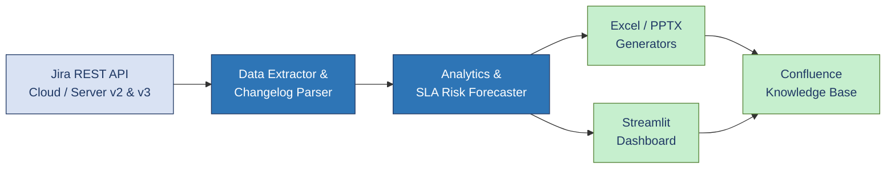
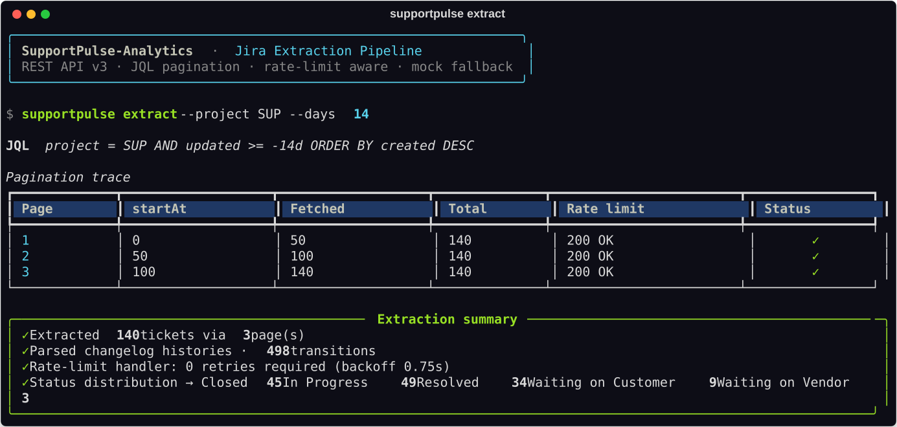
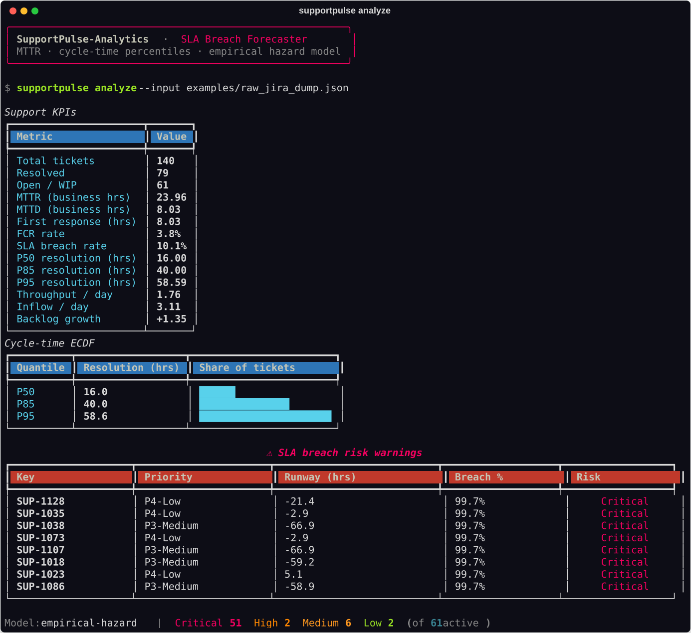
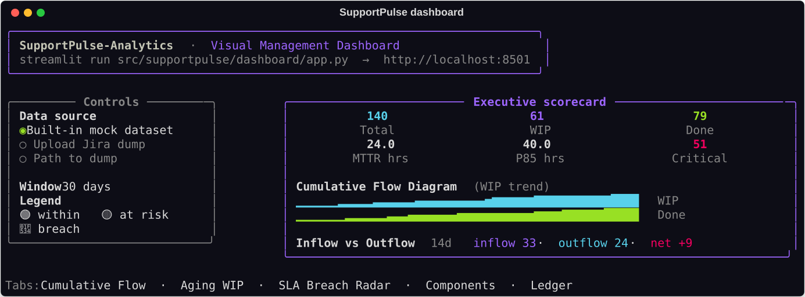
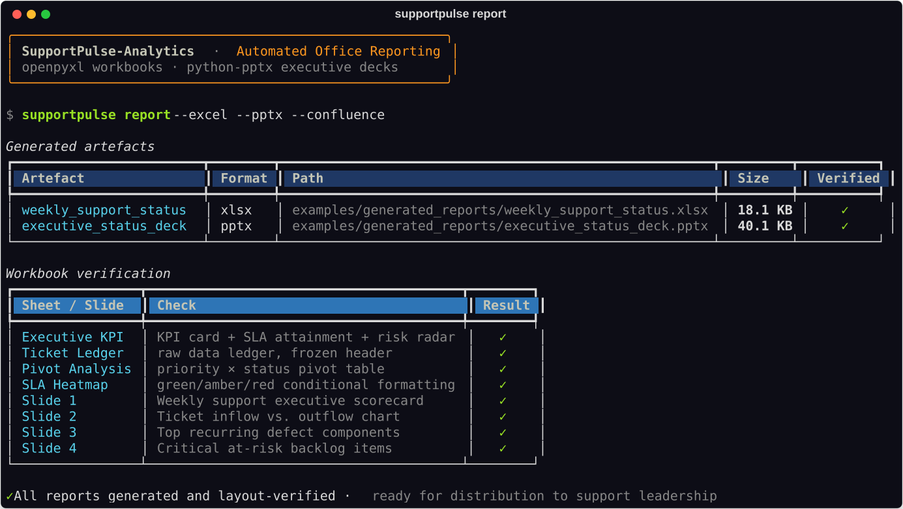

<div align="center">

# SupportPulse-Analytics

**Jira support pipeline · SLA breach forecaster · visual management reporting engine**

[](.gitlab-ci.yml)
[](pyproject.toml)
[](LICENSE)
[](#testing--quality)
[](Dockerfile)

*Bridging raw Jira ticket streams and executive visual management — automatically, at scale.*

</div>

---

## Context & Problem Statement

Enterprise software support organisations run on Jira. Every day, hundreds of
tickets move through triage, engineering hand-offs and customer follow-ups, and
every one of them carries a contractual SLA clock. The operational reality is
that the *signal* leadership needs — are we about to breach? where is work
piling up? which component keeps failing? — is buried in thousands of
changelog events that nobody has time to read.

**SupportPulse-Analytics closes that gap.** It extracts the ticket stream from
Jira, reconstructs each ticket's true lifecycle from its changelog, and turns it
into three things a support organisation can act on the same morning:

1. **Forecast, not post-mortem.** A statistical breach-risk engine scores every
   *active* ticket against its SLA runway, so escalations happen *before* the
   breach rather than in the weekly review.
2. **Executive-ready artefacts.** Formatted Excel workbooks and PowerPoint decks
   are produced automatically — no analyst copying numbers into slides.
3. **A living visual-management surface.** A Streamlit dashboard with Cumulative
   Flow Diagrams, aging WIP and an SLA breach radar gives the support tiers a
   shared, always-current picture of flow.

The result is a reproducible pipeline that scales from a single project key to
an entire support portfolio, and that speaks both the engineer's language
(JQL, changelogs, stage dwell) and the executive's (KPIs, trends, RAG heatmaps).

---

## Architecture Pipeline



**Pipeline stages**

| Stage | Module | What it does |
| --- | --- | --- |
| Extract | `extractor/jira_client.py`, `extractor/jql_builder.py` | JQL search with automatic pagination, exponential back-off and `429`/`5xx` rate-limit handling; offline mock mode. |
| Parse | `extractor/changelog_parser.py` | Reconstructs `Open → In Triage → In Progress → Waiting → Resolved → Closed`, computes per-stage dwell and detects Tier 1/2/Dev ping-pong. |
| Analyse | `analytics/metrics_engine.py`, `analytics/cycle_times.py` | MTTR, MTTD, FCR, breach rate, P50/P85/P95 percentiles, ECDFs, SLO recommendations and cumulative flow. |
| Forecast | `analytics/sla_forecaster.py` | Empirical-hazard breach probability per active ticket, remaining runway and escalation guidance. |
| Report | `reporters/excel_reporter.py`, `reporters/pptx_reporter.py`, `reporters/confluence_exporter.py` | Multi-tab workbook with SLA heatmaps, executive deck, and Confluence Storage Format / Markdown pages. |
| Visualise | `dashboard/app.py`, `dashboard/charts.py` | Streamlit CFD, aging WIP and SLA breach radar. |

---

## Skills Matrix — Rohde & Schwarz (Software Support)

| Qualification | Where it is demonstrated in this repository |
| --- | --- |
| **Jira automation & REST APIs** | `extractor/jira_client.py` — authenticated REST v2/v3 client, JQL construction (`jql_builder.py`), pagination, retry/back-off, changelog retrieval. |
| **Python data analysis** | `analytics/` — pandas/NumPy KPI engine, ECDFs, percentiles, and a statistical breach-risk model (`sla_forecaster.py`). |
| **MS Office report synthesis** | `reporters/excel_reporter.py` (openpyxl multi-tab workbook, conditional-formatting heatmaps) and `reporters/pptx_reporter.py` (python-pptx executive deck with native charts). |
| **Visual management & Lean flow** | `dashboard/` — Cumulative Flow Diagram, WIP tracking, aging WIP and a colour-coded SLA breach radar. |
| **Software support concepts** | SLA policies per priority (`config/sla_policies.yaml`), MTTR/MTTD/FCR, first-contact resolution, escalation runway and tier ping-pong analysis. |
| **Knowledge-base publishing** | `reporters/confluence_exporter.py` — Confluence Storage Format (XHTML) with status macros, plus Markdown. |
| **Engineering rigour** | Typed Pydantic models, GitLab CI (lint → test → build → pages), Docker/compose, and a pytest suite at **97%** coverage. |

---

## Visual Previews

**1 · Jira extraction pipeline — JQL pagination & rate-limit handling**



**2 · SLA forecaster analytics — MTTR, cycle-time percentiles & breach warnings**



**3 · Visual management dashboard — CFD, WIP & breach radar**



**4 · Automated Office reports — workbook & deck generation**



---

## Quickstart

```bash
# 1. Install (editable, with dev tooling)
pip install -e ".[dev]"

# 2. Extract the ticket stream (works offline — no Jira credentials needed)
supportpulse extract --mock

# 3. Analyse the backlog and forecast SLA breaches
supportpulse analyze --input examples/raw_jira_dump.json

# 4. Generate every reporting artefact
supportpulse report --excel --pptx --confluence

# 5. Launch the visual management dashboard
streamlit run src/supportpulse/dashboard/app.py
```

### Connecting to a real Jira instance

Provide credentials through the environment — no secrets ever live in the repo:

```bash
export SUPPORTPULSE_JIRA__BASE_URL="https://your-org.atlassian.net"
export SUPPORTPULSE_JIRA__EMAIL="you@example.com"
export SUPPORTPULSE_JIRA__API_TOKEN="<your-api-token>"
export SUPPORTPULSE_APP__MOCK_MODE="false"

supportpulse extract --project SUP --days 14
```

Any `config.yaml` key can be overridden with a `SUPPORTPULSE_<SECTION>__<FIELD>`
environment variable.

### CLI reference

| Command | Description |
| --- | --- |
| `supportpulse extract --project SUP --days 14` | Run JQL extraction and write a raw dump. |
| `supportpulse analyze --input dump.json` | Compute KPIs, SLA attainment and breach risk. |
| `supportpulse report --all` | Generate Excel, PowerPoint and Confluence deliverables. |
| `supportpulse dashboard` | Launch the Streamlit dashboard. |

---

## Docker

```bash
# Build and run the dashboard (http://localhost:8501)
docker compose up --build

# One-off CLI run inside the image
docker compose run --rm supportpulse-cli analyze --input examples/raw_jira_dump.json
```

Or with plain Docker:

```bash
docker build -t supportpulse-analytics:1.0.0 .
docker run --rm -p 8501:8501 supportpulse-analytics:1.0.0
```

---

## Project Layout

```text
supportpulse-analytics/
├── config/                 # runtime config + SLA policies (YAML)
├── docs/screenshots/       # generated dark-mode SVG previews
├── examples/               # mock Jira dump + generated reports
├── scripts/                # dataset generator, screenshot generator, git history
├── src/supportpulse/
│   ├── extractor/          # Jira REST client, JQL builder, changelog parser
│   ├── models/             # Pydantic schemas (ticket, SLA, metrics)
│   ├── analytics/          # KPI engine, cycle times, SLA forecaster
│   ├── reporters/          # Excel, PowerPoint and Confluence exporters
│   ├── dashboard/          # Streamlit app + Plotly charts
│   └── cli.py              # Rich/Click command-line interface
└── tests/                  # pytest suite
```

---

## Testing & Quality

```bash
pytest --cov=supportpulse --cov-report=term-missing
```

The suite covers extraction (including HTTP retry, rate-limit and pagination
paths), lifecycle parsing, KPI computation, the breach forecaster, all three
reporters, the chart builders and the CLI. Current coverage: **97%**.

## Regenerating assets

```bash
python scripts/generate_mock_jira_dataset.py   # refresh examples/raw_jira_dump.json
python scripts/generate_screenshots.py         # rebuild docs/screenshots/*.svg
bash   scripts/setup_git_history.sh            # rebuild the commit timeline
```

---

## License

Released under the [MIT License](LICENSE).

<div align="center"><sub>Built by Vinothkumar N · SupportPulse-Analytics v1.0.0</sub></div>
